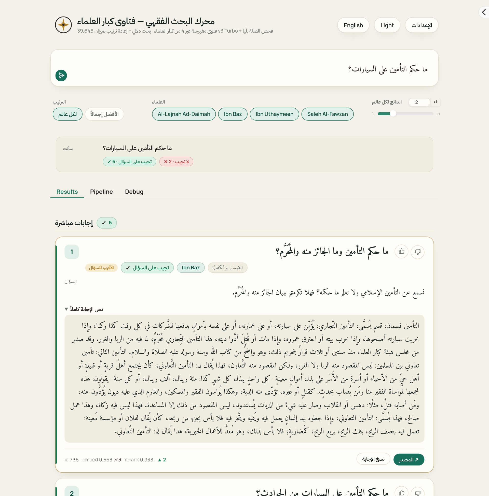
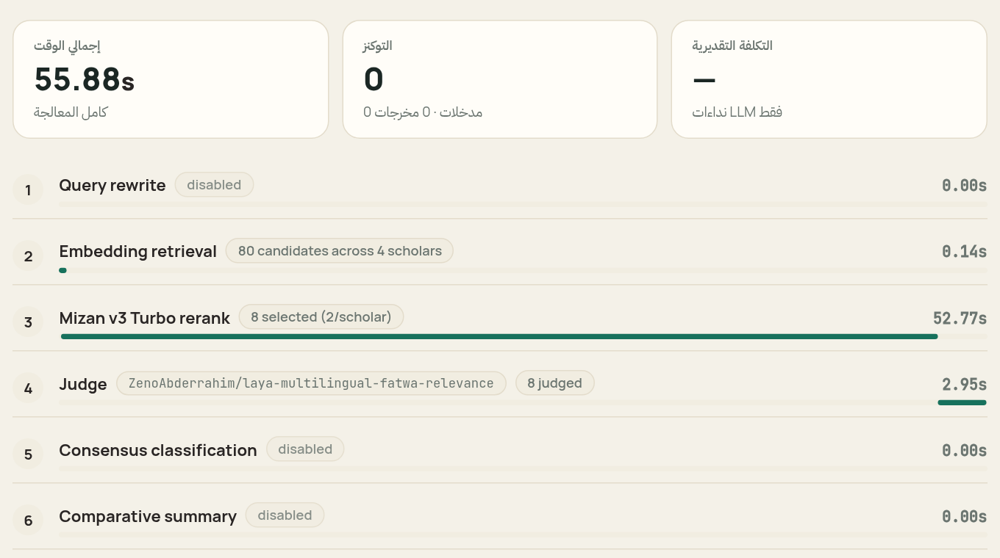
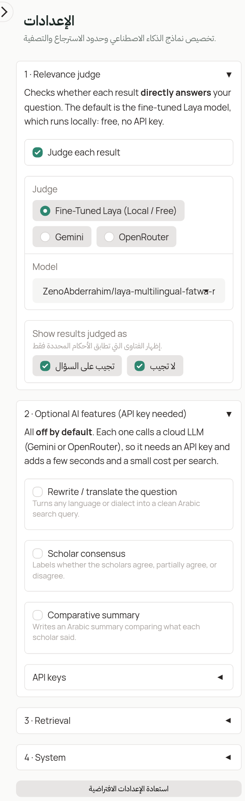
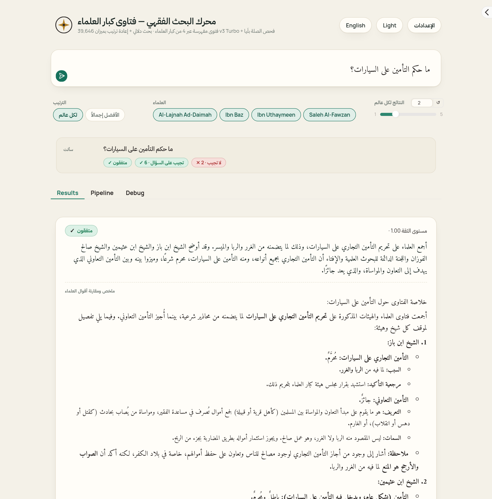
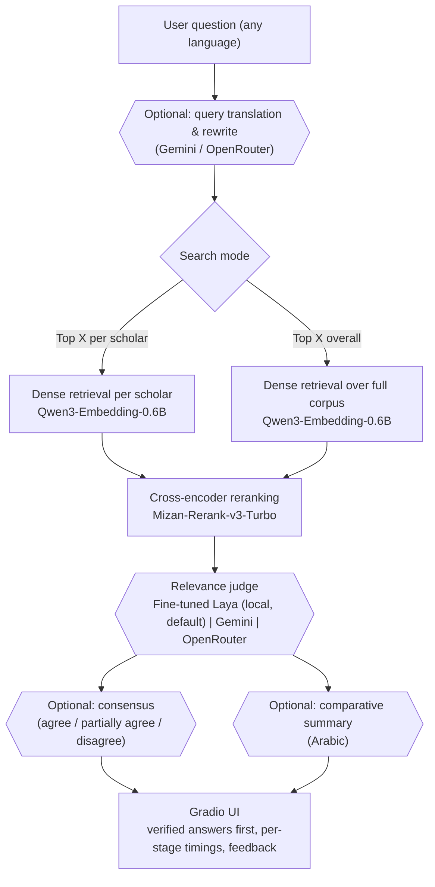

# Fatwa-RAG: Multi-Scholar Islamic Semantic Search with a Fine-Tuned Relevance Judge

A retrieval pipeline over **39,646 Arabic fatwas** from four major Saudi scholars and institutions. You ask a question in any language; the system retrieves candidate rulings with dense embeddings, reranks them with a cross-encoder, and has a **fine-tuned 322M-parameter classifier** decide which fatwas actually answer the question. It runs fully locally with no API keys; LLMs are optional add-ons.

[](requirements.txt)
[](LICENSE)
[](https://huggingface.co/ZenoAbderrahim/laya-multilingual-fatwa-relevance)
[](https://huggingface.co/datasets/ZenoAbderrahim/binbaz_fatwas_rag)
[](https://colab.research.google.com/github/AbderrahimZineddineEsi/BinBaz-RAG/blob/main/notebooks/02_run_on_colab.ipynb)



<table>
  <tr>
    <td width="68%" valign="top"></td>
    <td width="32%" valign="top"></td>
  </tr>
  <tr>
    <td valign="top"><b>Pipeline tab</b>: per-stage timings for the same query. The 53 s rerank comes from running on a 3 GB GTX 1050 laptop GPU (80 long fatwas, up to 2,048 tokens each), a hardware limit rather than a property of the pipeline.</td>
    <td valign="top"><b>Settings</b>: the local judge is on by default; cloud LLM features are off until you enable them.</td>
  </tr>
</table>

<details>
<summary>With the optional AI features on (scholar consensus + comparative summary)</summary>



</details>

## Highlights

- **End-to-end RAG pipeline**: query rewrite → dense retrieval → cross-encoder reranking → relevance judging → cross-scholar consensus and summary, behind a bilingual (Arabic/English) Gradio UI.
- **Fine-tuned relevance judge**: distilled GPT-4o Mini labels into a local 322M model ([on Hugging Face](https://huggingface.co/ZenoAbderrahim/laya-multilingual-fatwa-relevance)). Accuracy went from **61.4% to 83.5%** and recall on true answers from **27.6% to 86.4%**, at ~34 ms per decision and zero API cost.
- **Data pipeline built for it**: 10,044 GPT-4o Mini-labeled (question, fatwa) pairs, rebalanced with hard-negative mining into a 5,420-pair training set (details below).
- **Model selection backed by benchmarks**: picked the teacher LLM by comparing 7 judges against 100 hand-labeled examples, and picked the reranker by comparing Mizan V2 and v3-Turbo across 641 queries.
- **Human-in-the-loop**: thumbs up/down feedback in the UI is logged as training data for the next fine-tuning round.

## Tech Stack

| Area | Tools |
| :--- | :--- |
| Retrieval | `sentence-transformers`, [Qwen3-Embedding-0.6B](https://huggingface.co/Qwen/Qwen3-Embedding-0.6B), in-memory cosine search with PyTorch (no vector DB needed at ~40K × 1024) |
| Reranking | Cross-encoder [ALJIACHI/Mizan-Rerank-v3-Turbo](https://huggingface.co/ALJIACHI/Mizan-Rerank-v3-Turbo) (ModernBERT) |
| Fine-tuning | [`laya`](https://pypi.org/project/laya/) decision models (mmBERT encoder), PyTorch, DDP/`torchrun`-ready training notebook, scikit-learn metrics |
| LLMs (optional) | Google Gemini (`google-genai`), OpenRouter (GPT-4o, DeepSeek, Claude, JEV Decisions API), structured JSON outputs with Pydantic |
| App | Gradio (tested on 6.17), custom HTML/CSS cards, RTL Arabic support, light/dark themes |
| Data & infra | pandas, Hugging Face Hub (dataset + model hosting, auto-download), Kaggle GPU notebooks, Google Colab |

## How It Works



**Search modes**

- **Per scholar**: retrieves and reranks the top X fatwas for *each* selected scholar, so you can compare how different scholars answer the same question.
- **Overall**: one ranked list across the whole corpus. Larger scholars (Ibn Baz has ~half the corpus) can dominate.

**Interchangeable components.** Each stage can be switched in the UI settings: judge provider (local Laya, Gemini, or any OpenRouter model), rewrite model, consensus and summary models. Each stage also has its own device setting (CPU/CUDA). The **Pipeline** tab shows how long each stage took.

## Results

### 1. Fine-tuned relevance judge

The judge answers one question per candidate: *does this fatwa directly answer the user's question?* (`answers-it` / `does-not-answer`). Evaluated on **813 held-out pairs** (stratified 15% split):

| Model | Training data | Accuracy | Recall (`answers-it`) | F1 (`answers-it`) | Median latency (GPU) |
| :--- | :--- | :---: | :---: | :---: | :---: |
| Base `laya-multilingual` (zero-shot) | none | 61.38% | 27.6% | 0.408 | 29 ms |
| Fine-tuned, first iteration | 3,000 pairs, 250 questions | 81.55% | 68.0% | 0.776 | 30 ms |
| **Fine-tuned, final** ([HF](https://huggingface.co/ZenoAbderrahim/laya-multilingual-fatwa-relevance)) | **5,420 balanced pairs, 906 questions** | **83.52%** | **86.4%** | **0.835** | 34 ms |

The second iteration focused on **recall**. Rejecting a fatwa that actually answers the question is the worst failure for this app, because the user never sees that ruling. The base model missed 72% of true answers. The final model misses about 14%.

<details>
<summary>Accuracy per scholar (first vs final iteration)</summary>

| Scholar | Test pairs | First iteration | Final |
| :--- | :---: | :---: | :---: |
| Ibn Baz | 301 | 68.4% | **79.7%** |
| Ibn Uthaymeen | 158 | 80.4% | 79.1% |
| Al-Lajnah Ad-Da'imah | 127 | 89.8% | 83.5% |
| Abdullah al-Manee' | 79 | 98.7% | 94.9% |
| Saleh Al-Fawzan | 74 | 90.5% | **91.9%** |
| Abdulaziz Aal ash-Sheikh | 73 | 95.9% | 89.0% |
| Saleh bin Humaid | 1 | (too few samples) | (too few samples) |

The final model improved the most on Ibn Baz, the largest and hardest part of the corpus. It lost some accuracy on smaller scholars, where the first model's numbers were inflated: those test sets were mostly easy negatives.
</details>

### 2. Choosing the teacher LLM

This is a self-funded project, so the budget for API calls was small. That's why I only compared small, low-cost models ("mini", "flash" and "lite" tiers) rather than frontier ones, and why the end goal was a local model that costs nothing to run.

Before generating thousands of labels, I hand-labeled 100 candidates (14–16 per scholar) and benchmarked seven LLM judges against them ([`notebooks/04_evaluation_and_benchmarking.ipynb`](notebooks/04_evaluation_and_benchmarking.ipynb)). This was a 3-class task: answers it / related only / unrelated.

| Judge | Accuracy | Macro F1 | Projected cost per 10K labels |
| :--- | :---: | :---: | :---: |
| **GPT-4o Mini** | **89%** | **0.823** | $0.78 |
| Gemini 3.5 Flash Lite | 80% | 0.759 | $2.76 |
| DeepSeek Flash v4.1 | 79% | 0.756 | $2.88 |
| Claude Haiku 5.5 | 77% | 0.742 | $2.37 |
| JEV Decision Engine | 76% | 0.710 | $0.32 |
| Gemini 2.5 Flash | 79% | 0.640 | $2.67 |
| Base Laya (local, zero-shot) | 49% | 0.393 | $0.00 |

GPT-4o Mini was both the most accurate and one of the cheapest, so it became the teacher. Labeling all 10,044 training pairs with it cost about $1.10. The weak zero-shot Laya score is the reason I fine-tuned it.

### 3. Reranker upgrade: Mizan V2 → v3-Turbo

The app first used `Mizan-Rerank-V2`. I re-scored the full 10,044-pair labeled pool with each reranker ([`notebooks/05_kaggle_mizan_v3_turbo_rerank_and_benchmark_10k.ipynb`](notebooks/05_kaggle_mizan_v3_turbo_rerank_and_benchmark_10k.ipynb)). Metrics cover the **641 questions** that have at least one fatwa labeled `answers-it` by GPT-4o Mini:

| Metric | Qwen3 embedder only | Mizan-Rerank-V2 | **Mizan-Rerank-v3-Turbo** |
| :--- | :---: | :---: | :---: |
| Hit@1 | 74.7% | 74.0% | **78.3%** |
| MRR | 0.841 | 0.843 | **0.855** |
| MAP | 0.786 | 0.799 | **0.809** |
| NDCG@3 | 0.769 | 0.777 | **0.792** |
| NDCG@10 | 0.860 | 0.867 | **0.871** |
| Hit@3 | 92.7% | **94.2%** | 91.6% |
| ROC-AUC | 0.828 | **0.911** | 0.868 |

v3-Turbo puts the correct ruling first more often (+4.4 pp Hit@1), which is what matters most in the UI. V2 is still better at separating relevant from irrelevant pairs overall (ROC-AUC). The Laya judge handles that separation in this pipeline, so v3-Turbo became the default. It also supports longer inputs (2,048 tokens are used here vs 1,024 for V2), so long fatwas get truncated less.

## Training Data: How the 5,420-Pair Set Was Built

The training set had to be balanced on purpose. Raw retrieval candidates are mostly negatives, and a model trained on them learns to say "does not answer" to everything.

1. **Questions**: 950 hand-curated jurisprudence questions in three batches: [250 broad](data/250_fatwa_relevance_questions.csv), [500 niche fiqh topics](data/500_fatwa_relevance_questions.csv), and [200 targeted at the three largest sources](data/200_big3_questions.csv).
2. **Candidate generation (9,000 pairs)**: for the first 750 questions, the retrieval + reranking pipeline produced the top candidates with a fixed quota per scholar ([`01_kaggle_dataset_generation_and_labeling_9k.ipynb`](notebooks/01_kaggle_dataset_generation_and_labeling_9k.ipynb)). GPT-4o Mini labeled every pair.
   - Result: only **2,049 positives (22.8%)** vs 6,951 negatives. Smaller scholars had very few true answers. Saleh bin Humaid has only 48 fatwas, which produced just 7 positives out of 750 candidates.
3. **Targeted expansion (+1,044 pairs)**: to get more positives, the 200 "Big 3" questions were run only against Ibn Baz, Ibn Uthaymeen and Al-Lajnah, which together hold 95% of the corpus ([`01_kaggle_dataset_generation_and_labeling_6k_balanced.ipynb`](notebooks/01_kaggle_dataset_generation_and_labeling_6k_balanced.ipynb)). 53% of these candidates were positives (557 new), vs 23% in the first batch.
4. **Balancing with hard negatives**: all **2,606 positives** were kept. Negatives were downsampled to **2,814**, keeping the ones with the *highest* reranker scores, capped per scholar. These are fatwas on the right topic that still don't answer the question, which are the cases the judge has to learn to reject.
5. **Split**: stratified 85/15 → 4,607 training pairs, 813 held-out test pairs.

Final set: **5,420 pairs, 48.1% positive / 51.9% negative, 906 distinct questions, 29 fiqh categories.** The total labeling cost for all 10,044 pairs was about **$1.10** in GPT-4o Mini calls.

> The Hugging Face model is named "9K" after the 9,000-pair candidate pool it came from. The model was trained on the 5,420 balanced pairs selected from that pool and the expansion.

## Corpus

| Scholar / institution | Arabic | Fatwas |
| :--- | :--- | ---: |
| Sheikh Abdulaziz ibn Baz | الشيخ عبد العزيز بن باز | 19,727 |
| Sheikh Muhammad ibn Saalih al-Uthaymeen | الشيخ محمد بن صالح العثيمين | 9,119 |
| Al-Lajnah Ad-Da'imah (Permanent Committee) | اللجنة الدائمة للبحوث العلمية والإفتاء | 9,086 |
| Sheikh Saleh Al-Fawzan | الشيخ صالح بن فوزان الفوزان | 1,714 |
| **Total indexed** | | **39,646** |

Three smaller sources are also in the cleaned dataset but are **excluded from search**: Abdullah al-Manee' (233 fatwas), Abdulaziz Aal ash-Sheikh (135) and Saleh bin Humaid (48). With so few fatwas, they rarely contain an answer to a given question. They mostly added near-miss results and made the per-scholar mode noisy. They were still used when building and evaluating the judge (the numbers above cover all seven sources). Re-enabling them is a one-line change to `INCLUDED_SCHOLARS` in `app.py`.

Text cleaning is deliberately light: encoding repair, NFKC normalization, removal of scraping artifacts, and deduplication. There is no stemming and no diacritic stripping. Each fatwa is embedded as `title + answer` up to 1,024 tokens. 1,355 of the 40,062 fatwas (3.4%) are longer and get truncated for embedding only; the full text is always shown. The cleaned corpus and embeddings are published as a [Hugging Face dataset](https://huggingface.co/datasets/ZenoAbderrahim/binbaz_fatwas_rag).

## Quick Start

### Option A: Google Colab (no setup)

1. Open [`notebooks/02_run_on_colab.ipynb`](https://colab.research.google.com/github/AbderrahimZineddineEsi/BinBaz-RAG/blob/main/notebooks/02_run_on_colab.ipynb).
2. **Runtime → Change runtime type → T4 GPU**.
3. Optional: add `GEMINI_API_KEY` or `OPENROUTER_API_KEY` to **Colab Secrets** to enable the LLM features.
4. Run all cells. The app starts with a public `*.gradio.live` link.

### Option B: Run locally

```bash
git clone https://github.com/AbderrahimZineddineEsi/BinBaz-RAG.git
cd BinBaz-RAG
python3 -m venv .venv && source .venv/bin/activate
pip install -r requirements.txt

cp .env.example .env   # optional: add GEMINI_API_KEY / OPENROUTER_API_KEY
python app.py          # opens http://127.0.0.1:7860
```

On first launch, `app.py` downloads the corpus and embeddings (~170 MB) from the [Hugging Face dataset](https://huggingface.co/datasets/ZenoAbderrahim/binbaz_fatwas_rag) into `data/`. Without API keys, retrieval, reranking and the Laya judge all still work. Only rewrite, consensus and summary are disabled.

### Hardware

| Model | Params | Approx. VRAM |
| :--- | :---: | :---: |
| Qwen3-Embedding-0.6B | 0.6B | ~2.8 GB |
| Mizan-Rerank-v3-Turbo | 149M | ~0.3 GB (fp16 on GPU) |
| Laya fatwa-relevance judge | 322M | ~1.3 GB |

```bash
# 3–4 GB GPU (e.g. GTX 1050): embedder on CPU, the rest on GPU (~2.6 GB used in testing)
python app.py --embedder-device cpu --reranker-device cuda --judge-device cuda

# 6 GB+ GPU or Colab T4: everything on GPU
python app.py --embedder-device cuda --reranker-device cuda --judge-device cuda

# CPU only
python app.py --embedder-device cpu --reranker-device cpu --judge-device cpu
```

### CLI options

| Flag | Default | Description |
| :--- | :--- | :--- |
| `--embedder-device` | `cpu` | `cpu`, `cuda`, or `auto` |
| `--reranker-device` | `auto` | `auto`, `cuda`, or `cpu` |
| `--judge-device` | `auto` | `auto`, `cuda`, or `cpu` (local Laya judge) |
| `--data-dir` | `./data` | Corpus + embeddings folder (or set `FATWA_DATA_DIR`) |
| `--no-download` | off | Don't fetch missing files from Hugging Face |
| `--no-warmup` | off | Skip the startup warmup query |
| `--host` / `--port` | `127.0.0.1` / `7860` | Server address |
| `--share` | off | Create a temporary public Gradio link |
| `--no-browser` | off | Don't open a browser tab on startup |

## Repository Layout

```
app.py                      # the whole application: pipeline, providers, Gradio UI
data/                       # curated question sets, human labels, benchmark predictions
docs/architecture.md        # pipeline stages and design decisions
notebooks/
  01_clean_multi_scholar_datasets.ipynb           # cleaning + merging the 7 sources
  01_build_corpus_and_embeddings_kaggle.ipynb     # embedding the corpus on Kaggle GPUs
  01_kaggle_dataset_generation_and_labeling_*.ipynb  # candidate generation + GPT-4o Mini labeling
  02_kaggle_laya_eval_and_finetune_9k.ipynb       # zero-shot eval, fine-tuning, held-out test
  03_retrieval_evaluation_kaggle.ipynb            # early retrieval experiments (original vs rewritten queries)
  04_evaluation_and_benchmarking.ipynb            # human labeling UI + 7-judge LLM benchmark
  05_kaggle_mizan_v3_turbo_rerank_and_benchmark_10k.ipynb  # reranker comparison
  02_run_on_colab.ipynb                           # run the app on Colab
scripts/                    # question-set generators
archive/                    # earlier notebook iterations, kept for reference
```

## Limitations & Next Steps

- **The labels come from an LLM.** Training labels and the reranker benchmark use GPT-4o Mini as ground truth. GPT-4o Mini agreed with my hand labels 89% of the time, so some label noise is built in.
- **The split is per pair, not per question.** The same question can appear in both train and test. A split grouped by question would give a stricter estimate of how well the judge generalizes to new questions.
- **Coverage is limited to four sources.** The three smallest sources are excluded from search (see [Corpus](#corpus)). Adding more scholars would need larger archives to scrape.
- **Next steps:** retrain on in-app feedback, extract Quran and Hadith citations from answers, and make query rewriting more robust to dialect and colloquial phrasing.

## License & Disclaimer

MIT License, see [LICENSE](LICENSE).

This is a research and retrieval tool, not a source of religious rulings. Always check fatwas and AI-generated summaries against the original sources and consult qualified scholars.
