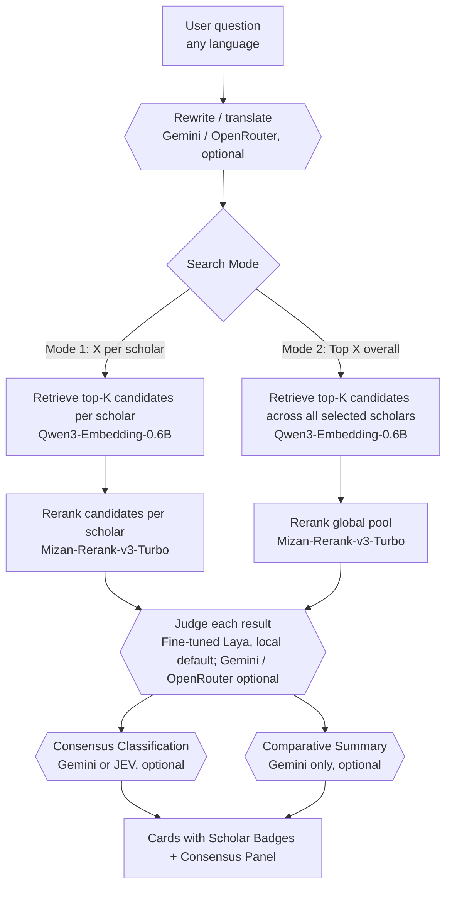

# Architecture

How the multi-scholar fatwa search and AI consensus works, and why it is built this way.

## 1. Overview

A query passes through up to six stages. Retrieval, reranking and the default relevance judge (a fine-tuned Laya model) run locally and need no API keys. The LLM stages (query rewrite, consensus classification and comparative summary) are modular and optional.

| Stage | What it does | Default model |
| --- | --- | --- |
| **Rewrite (optional)** | Converts any language or colloquial dialect into a canonical Arabic search query. | `gemini-2.5-flash` |
| **Retrieve (Mode 1)** | Encodes the query and takes the top cosine candidates independently for each selected scholar. | `Qwen/Qwen3-Embedding-0.6B` |
| **Retrieve (Mode 2)** | Encodes the query and takes the top cosine candidates across the unified multi-scholar pool. | `Qwen/Qwen3-Embedding-0.6B` |
| **Rerank** | Cross-encoder rescores each (query, fatwa) pair and orders candidate fatwas. | `ALJIACHI/Mizan-Rerank-v3-Turbo` |
| **Judge** | Labels each shown result `answers-it` or `does-not-answer`. | Fine-tuned Laya (`ZenoAbderrahim/laya-multilingual-fatwa-relevance`), local; Gemini, OpenRouter or JEV as alternatives |
| **Consensus (optional)** | Classifies whether retrieved scholars agree (`agree`), partially agree (`partially-agree`), or diverge (`disagree`). | Gemini or JEV |
| **Summary (optional)** | Synthesizes an objective Arabic summary comparing the scholars' positions with attribution. | Gemini |

---

## 2. Multi-Scholar Corpus

The cleaned corpus holds **40,062 fatwas** from seven sources. The app indexes the **four largest (39,646 fatwas)**. The three smallest sources are kept in the dataset but excluded from search, because a few hundred fatwas or fewer is too little coverage to answer most questions (see `INCLUDED_SCHOLARS` in `app.py`):

| Scholar / Source | Fatwas | Origin / Provenance | Indexed |
| --- | --- | --- | :---: |
| **Sheikh Abdulaziz ibn Baz** | 19,727 | Official portal `binbaz.org.sa` | yes |
| **Sheikh Muhammad ibn Saalih al-Uthaymeen** | 9,119 | Official fatwas archive `ibnothaymeen.com` | yes |
| **Al-Lajnah Ad-Da'imah lil-Ifta / Council of Senior Scholars** | 9,086 | General Presidency of Scholarly Research and Ifta (`alifta.gov.sa`) | yes |
| **Sheikh Saleh Al-Fawzan** | 1,714 | Official lessons & rulings archive | yes |
| **Sheikh Abdullah al-Manee'** | 233 | Council of Senior Scholars (`alifta.gov.sa`) | excluded |
| **Sheikh Abdulaziz Aal ash-Sheikh** | 135 | Grand Mufti corner (`alifta.gov.sa`) | excluded |
| **Sheikh Saleh bin Humaid** | 48 | Council of Senior Scholars (`alifta.gov.sa`) | excluded |
| **Total** | **40,062** | Unified master index (`multi_scholar_clean.csv`) | 39,646 |

### Preprocessing & Corrections:
- **Uthaymeen Title Extraction:** Resolved a major scraping flaw in raw corpora where ~90% of fatwa titles were generic hierarchy breadcrumbs (e.g. `الطهارة >> المياه`), while the specific question/ruling title was stored in category metadata. The cleaning pipeline extracts the specific title to anchor semantic embeddings.
- **Al-Lajnah Ad-Da'imah Hierarchy Cleanup:** Stripped administrative navigation prefixes (`تصفح برقم المجلد >> ...`) into clean topic titles while keeping volume numbers in metadata.
- **Corrupted Record Pruning:** Discarded entries without answer bodies or with unresolvable scraping failures.
- **Normalization:** Light-touch NFKC normalization, `ftfy` mojibake repair, and HTML entity stripping without altering Arabic orthography or diacritics.

---

## 3. Search Modes

Users can toggle between two retrieval modes based on search intent:

1. **Mode 1: X Answers per Scholar (`per_scholar`)**:
   - Searches and reranks each scholar's sub-index separately.
   - Guarantees exactly X answers for each selected scholar (e.g. 2 fatwas from Ibn Baz, 2 from Ibn Uthaymeen, 2 from Al-Lajnah Ad-Da'imah).
   - Prevents a single prolific scholar from dominating the result list and enables direct, balanced side-by-side comparison.
2. **Mode 2: Top X Answers Overall (`overall`)**:
   - Considers all fatwas from all selected scholars as one unified pool.
   - Sorts candidates purely by reranker score, finding the single best answers regardless of which scholar issued them.

---

## 4. AI Consensus & Comparative Synthesis

When multiple scholars' fatwas are retrieved, users frequently want to know: *Do they agree on this issue, and what are their respective stances?*

1. **Consensus Classification:**
   - **`agree`:** All scholars agree on the core ruling.
   - **`partially-agree`:** General agreement on the fundamental ruling with differences in conditions, details, or exceptions.
   - **`disagree`:** Substantive disagreement (e.g. permissible vs prohibited, obligatory vs recommended).
   - Supported via **Gemini** (structured JSON schema) or **JEV** (`typesafe/jev-*` via OpenRouter Decisions API).
2. **Comparative Summary (Gemini):**
   - Synthesizes an objective, coherent Arabic summary stating what each scholar concluded, highlighting points of consensus and points of nuance.

---

## 5. Hardware & Scalability

- **Unified In-Memory Index:** At ~40K × 1,024 floats, the normalized float32 embedding matrix is about 160 MB. A single matrix multiply over it takes milliseconds, so an external vector database would add complexity without a speed benefit at this scale.
- **Reranker Memory Footprint:** `ALJIACHI/Mizan-Rerank-v3-Turbo` (149M-parameter ModernBERT) needs roughly 0.6 GB of VRAM, so it fits next to the Laya judge on a 3 GB laptop GPU such as a GTX 1050.
- **Graceful Asset Fallback:** The application seamlessly falls back to the Bin Baz base corpus if the new multi-scholar `.pt` embeddings have not yet been downloaded, ensuring zero-downtime development and testing.
